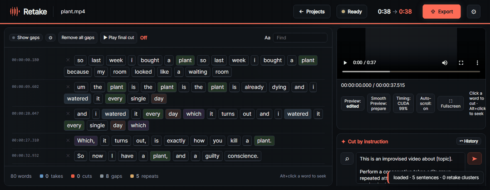

<h1 align="center">Retake</h1>

<p align="center">
  <b>Cut your video by deleting words.</b><br>
  Drop in a recording, get a transcript, strike out the takes you fumbled, and export the video with them gone.
  Everything runs on your machine.
</p>

<p align="center">
  <a href="#install"><b>Install</b></a> ·
  <a href="#edit-it-with-claude"><b>Edit it with Claude</b></a> ·
  <a href="docs/GUIDE.md"><b>How it works</b></a>
</p>

<p align="center">
  <a href="LICENSE"></a>
  
  
  
</p>

<p align="center">
  
  <br><sub>A 38-second recording with three false starts. Click the words, and it's an 18-second video.</sub>
</p>

---

## Why

I record improvised, off a teleprompter, and I say most lines two or three times before one comes out right. Cutting
that on a timeline means scrubbing for every restart. In Retake you read the transcript, click the words you don't
want, and the cut follows: the breath before a deleted sentence and the pause after it go with it, and a word you kept
is never clipped.

## What it does

- **Transcribes locally** with faster-whisper (large-v3-turbo, on the GPU when there is one), with word-level
  timestamps. Nothing is uploaded anywhere.
- **Shows you the retakes.** Words and lines you said more than once are colour-coded, and repeated attempts at a
  line are grouped as takes, so the restarts stand out before you've played anything.
- **Cuts by word.** Click a word to cut it, Alt+click or double-click to jump there. Play the final cut before you
  export.
- **Cuts by instruction.** Paste an edit list in English or Arabic ("cut 'so last week'", "keep the last take", a
  timestamp) and Retake resolves it to exact words for you to check. Anything it can't match, it tells you instead of
  guessing.
- **Exports a real video.** H.264/AAC MP4, NVIDIA encoding when available, checked packet by packet before it's
  handed over. Optional voice cleanup levels speech to −16 LUFS. You can also export EDL, SRT, CSV or plain text.
- **Takes files from your phone.** Open the LAN link Retake prints, pick a video, and the upload resumes on its own
  if the connection drops.

## Install

You need Python 3.11 and about 2 GB for the models.

```bash
git clone https://github.com/AhmedHeshamEG/Retake.git
cd Retake
python -m venv .venv
.venv\Scripts\activate         # macOS/Linux: source .venv/bin/activate
pip install -r requirements.txt
```

Retake never downloads anything while it runs, so fetch the models into `models/` once:

```bash
python -c "from faster_whisper.utils import download_model as d; d('large-v3-turbo', cache_dir='models')"
python -c "from sentence_transformers import SentenceTransformer as S; S('all-MiniLM-L6-v2', cache_folder='models')"
```

Then:

```bash
python retake.py
```

It opens `http://localhost:8710`. On Windows, `Start Retake.cmd` does the same with the `.venv`.

Docker works too: `docker compose up --build`, with `-f compose.yaml -f compose.gpu.yaml` for an NVIDIA GPU. Your
`models/` and `projects/` folders are mounted in, so they survive rebuilds.

Precise word timing (WhisperX) and voice cleanup (DeepFilterNet3) are optional extras with their own runtimes. Setup
for both is in the [guide](docs/GUIDE.md#optional-runtimes).

## Edit it with Claude

Retake ships an MCP server, so Claude (or any MCP client) can edit for you: "cut the bit where I fumbled the sponsor
read". The model works out what you meant; Retake decides which real words that is, and answers with token IDs and
timestamps, or says it couldn't find them. A client can't delete a raw time range or invent a word that isn't in the
transcript. Every edit previews first and can be undone.

```json
{
  "mcpServers": {
    "retake": { "command": "python", "args": ["/path/to/Retake/retake_mcp.py"] }
  }
}
```

The running editor also serves the same tools over HTTP at `http://localhost:8710/mcp`. The
[`retake-brain`](skills/retake-brain/SKILL.md) skill turns a raw recording into a cut list ("last complete attempt
wins") and applies it through the server. The full tool list is in [`docs/MCP.md`](docs/MCP.md).

## Projects and tests

Each project is a folder under `projects/` with the original media, `project.json` and its exports. Opening a project
again never transcribes it again.

```bash
python test_retake.py
```

## Licence

[MIT](LICENSE)
